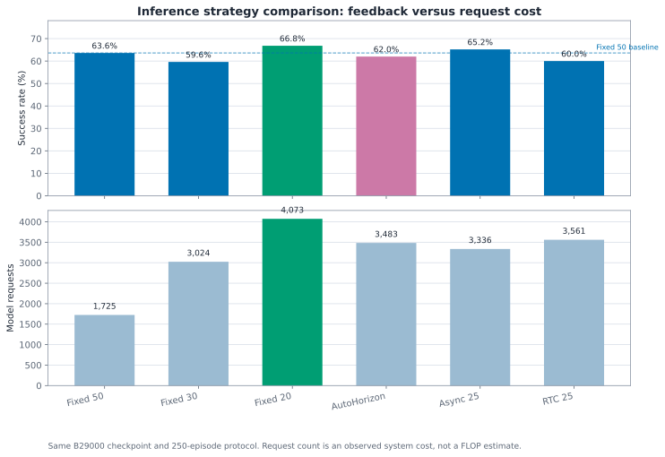
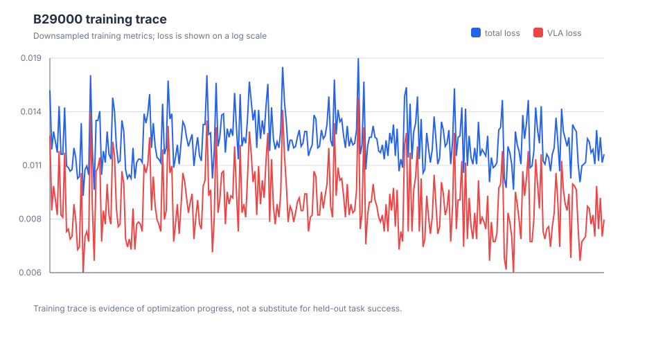

# LingBot-VLA：后训练、推理优化与分层具身 Agent

> 一个面向双臂操作的 VLA 项目：我从后训练 checkpoint 出发，系统比较动作执行策略，再把 RPent 风格的规划、工具调用、VLA 执行和经验记忆接成闭环，并用统一的仿真评测验证每一步带来的变化。

本仓库用于**展示项目做了什么、如何验证、结果说明什么**。它不是一份从零复现实验的安装教程：模型权重、数据、仿真资产、集群环境和 API 凭据均未公开。

## 项目亮点

- **后训练**：建立 SFT、增强训练、ActionEMA 以及 A/B/C 路线 checkpoint 的对照，保留每个回合的任务、场景、seed 和失败类型。
- **推理侧优化**：在同一个 B29000 checkpoint 上比较固定 50/30/20 步、AutoHorizon、异步 25 步和 RTC 25 步，记录成功率、请求次数和单次模型前向时间。
- **分层 Agent**：将高层任务规划、结构化工具调用、VLA 动作块、反馈分析和冻结经验记忆连接起来；对规划失败、接口错误和正常任务失败分别记账。
- **评测工程**：固定 25 个任务、clean/randomized 两种 setting 和公共场景，支持断点续跑、逐回合账本和任务级分析，避免只展示成功案例。

## 结果先看

### 后训练 checkpoint

下图展示了 5 个自训 checkpoint 在 250 个回合上的成功率。每个 checkpoint 都包含 125 个 clean 和 125 个 randomized 回合。


| checkpoint | clean | randomized | overall |
| --- | ---: | ---: | ---: |
| M0 | 76.0% | 34.4% | 55.2% |
| M1 | 78.4% | 38.4% | 58.4% |
| M2 | 75.2% | 36.0% | 55.6% |
| M3 | 81.6% | 36.0% | 58.8% |
| **M4** | **85.6%** | **40.0%** | **62.8%** |

M4 是本组候选中表现最好的 checkpoint。独立服务器上的 B29000 复核为 159/250（63.6%）；C 路线 student 和 dynamic-EMA teacher 均为 151/250（60.4%）。这些结果支持 checkpoint 选择结论，但不能把多项训练改动的共同收益归因给某一个单独技巧。

### 推理策略



| 策略 | 成功率 | clean | randomized | 请求次数 | 相对固定 50 |
| --- | ---: | ---: | ---: | ---: | ---: |
| 固定 50 步 | 63.6% | 107/125 | 52/125 | 1,725 | — |
| 固定 30 步 | 59.6% | 103/125 | 46/125 | 3,024 | -4.0 pp |
| **固定 20 步** | **66.8%** | 110/125 | 57/125 | 4,073 | +3.2 pp |
| AutoHorizon | 62.0% | 106/125 | 49/125 | 3,483 | -1.6 pp |
| Async 25 | 65.2% | 110/125 | 53/125 | 3,336 | +1.6 pp |
| RTC 25 | 60.0% | 105/125 | 45/125 | 3,561 | -3.6 pp |

固定 20 步在本组协议下成功率最高，但请求次数约为固定 50 步的 2.36 倍，因此这里体现的是反馈频率和执行开销之间的折中，不能直接写成“纯推理加速”。

### Agent 闭环

官方 RPent 方案在 250 个回合中完成 162 次（64.8%），其中 clean 为 107/125，randomized 为 55/125。它证明了规划—工具—VLA—反馈链路可以稳定运行，并提供了细粒度执行证据。

旧自定义 Agent 的纯 VLA、无记忆和冻结记忆结果分别为 63.6%、57.2% 和 60.4%。官方 Agent 与旧纯 VLA 的初态、环境版本和 seed 处理并非完全同源，因此这些数字用于说明工程结果和诊断方向，不能作为严格的因果增益声明。

## 训练与任务级证据



训练 loss 下降说明优化过程收敛，但最终判断仍以留出任务成功率为准。任务级热力图用于发现“总体平均值掩盖的回归”：


公开数据表可直接查看具体分母和失败情况：

- [`results/checkpoint_summary.csv`](results/checkpoint_summary.csv)：每个 checkpoint 的 clean/randomized 汇总。
- [`results/per_task_checkpoint.csv`](results/per_task_checkpoint.csv)：25 个任务 × 5 个 checkpoint 的任务级结果。
- [`results/inference_comparison.csv`](results/inference_comparison.csv)：推理策略、请求次数和模型前向时间。
- [`results/training_b29000.csv`](results/training_b29000.csv)：脱敏后的 B29000 训练曲线采样。

## 我实际完成的工作

1. **统一评测协议**：固定任务集合、公共场景、checkpoint、seed、精度、去噪步数、动作块长度和成功判据；把环境初始化失败、专家规划失败、接口异常和模型正常失败分开记录。
2. **完成后训练对比**：从训练日志、checkpoint 和逐回合账本建立“训练变化 → 仿真表现”的证据链，并保留 clean 与 randomized 两种难度。
3. **实现推理策略接口**：把固定动作块、AutoHorizon、异步执行和 RTC 放在同一 VLA 客户端边界下比较，避免策略差异混入模型权重切换。
4. **实现分层 Agent**：接入结构化规划、动作原语、VLA qpos14 适配、反馈分析、冻结经验和断点账本，并为 API 重试、端口隔离和续跑设计了可审计状态。
5. **分析失败案例**：从逐回合日志定位预算耗尽、随机化初态、动作漂移、工具调用错误和环境故障，避免把所有失败笼统归为“模型能力不足”。

## 系统如何协作

```text
任务目标 + RGB/状态
        │
        ▼
规划器 / 冻结经验 ──► 动作原语与恢复决策
        │                         │
        └────────► LingBot-VLA ───┘
                              │
                              ▼
                   动作块执行 / AutoHorizon / RTC
                              │
                              ▼
                 仿真状态、成功判据、细粒度账本
```

代码职责和调用关系见 [`ARCHITECTURE.md`](ARCHITECTURE.md)；实验协议和结果边界见 [`docs/experiment-protocol.md`](docs/experiment-protocol.md) 与 [`docs/results-summary.md`](docs/results-summary.md)。

## 结果边界

- 结果来自内部固定协议，不是官方排行榜成绩。
- 公开仓库提供摘要和证据表，不提供权重、数据、视频、仿真资产、集群路径或 API 密钥。
- 任务级成功率的分母始终保留；未完成回合不会被从统计中删除。
- 不同服务器或不同环境的结果只有在协议、初态和 seed 同源时才适合做严格因果比较。

## 第三方与许可

LingBot-VLA、RoboTwin、RPent 以及相关依赖保留各自版权和许可证。本项目只发布个人实现、最小补丁、脱敏结果和第三方声明；详见 [`THIRD_PARTY_NOTICES.md`](THIRD_PARTY_NOTICES.md) 与 [`PUBLIC_SCOPE.md`](PUBLIC_SCOPE.md)。
