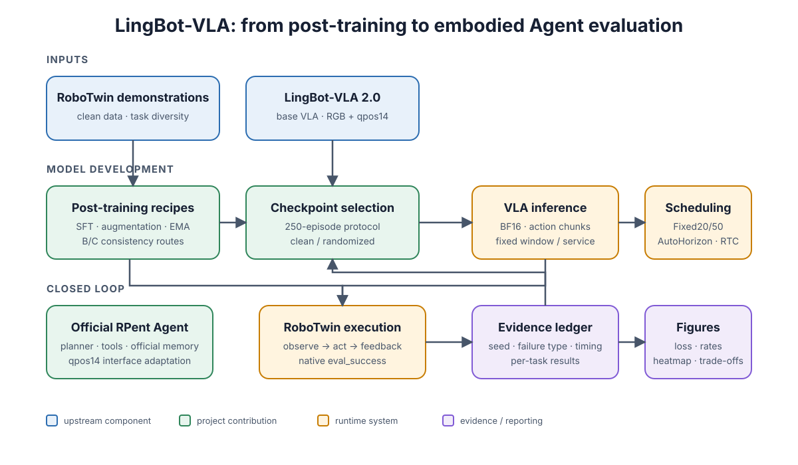

# LingBot-VLA：Post-Training、Inference Optimization 与 RPent Agent

一个面向双臂操作 VLA 的 Research + Engineering 项目：从 LingBot-VLA 2.0 后训练开始，比较不同 checkpoint 和推理策略，再将选定的 VLA 接入官方 RPent Agent，形成从模型训练、闭环评测到高层规划的完整链路。

## Demo

> **Demo 视频区域预留。** 后续会从成功的 RoboTwin 回合中选择少量代表性视频，并在每个视频旁标注任务、setting、checkpoint、推理策略和 seed。当前先使用系统架构图、训练曲线、成功率图和任务热力图展示结果，避免把早期 smoke 录像误写成正式结果。

## Highlights

| 方向 | 项目结果 |
| --- | --- |
| 后训练 | 比较 SFT、视觉增强、ActionEMA、B/C 路线，按同一 250 回合协议选择 checkpoint |
| checkpoint 选择 | B29000 在当前候选中达到 157/250（62.8%），作为后续推理和 Agent 实验的底层权重 |
| 推理策略 | Fixed20 达到 167/250（66.8%）；请求次数约为 Fixed50 的 2.36 倍 |
| Agent 集成 | 官方 RPent Agent 完成 250 回合评测，结果为 162/250（64.8%） |

## 项目主线

```text
LingBot-VLA 2.0
      │
      ▼
Post-Training Experiments
SFT · Augmentation · EMA · B/C routes
      │
      ▼
RoboTwin Evaluation
Clean / Randomized · checkpoint selection
      │
      ▼
Inference Optimization
Fixed horizon · AutoHorizon · Async · RTC
      │
      ▼
Official RPent Agent Integration
Planning · Tools · Memory · VLA execution · Feedback
```

项目的重点不是提出一个孤立的新模型，而是把每次失败拆解到训练配方、动作执行调度或高层任务规划，分别验证哪一层真正影响闭环表现。

## 系统架构



项目贡献与上游组件的边界如下：

| 层级 | 依赖的上游能力 | 本项目完成的工作 |
| --- | --- | --- |
| VLA | LingBot-VLA 2.0 | 后训练路线、checkpoint 选择和 qpos14 服务接口 |
| 仿真 | RoboTwin 2.0 | 冻结任务/场景/seed，统一成功判据和失败记账 |
| 推理 | 动作块与 VLA 服务 | Fixed horizon、AutoHorizon、异步动作队列和 RTC 对照 |
| Agent | 官方 RPent | 官方规划器、工具和 memory 接入，以及 B29000 VLA 适配 |
| 分析 | 结果账本与可视化 | 逐任务结果、训练曲线、请求成本和热力图 |

## 评测协议

| 项目 | 设置 |
| --- | --- |
| 基础模型 | LingBot-VLA 2.0 6B |
| 训练数据 | RoboTwin clean 数据，50 个任务、2,500 条示教、549,787 帧 |
| 后训练资源 | 4×H100、FSDP2、Muon + AdamW、global batch 256 |
| 评测任务 | 25 个任务 × 2 个 setting × 5 个公共场景 = 250 回合/条件 |
| setting | `demo_clean` 与 `demo_randomized` |
| 单次推理 | BF16、10 次去噪、batch size 1、预测动作窗 50 |
| 成功判据 | RoboTwin 原生 `eval_success` |

每个回合保留唯一身份、checkpoint、任务、setting、场景、seed、动作请求、异常类型和最终结果。环境初始化失败、专家规划失败、接口异常与模型正常失败分开记账；只有预先定义的客观环境故障才允许按协议顺延 seed。

## Post-Training：路线比较与 checkpoint 选择

第一阶段建立 SFT 基线，再针对 clean 与 randomized 之间的差距比较视觉增强、动作 EMA 和 teacher 约束。不同路线同时改变了训练配方中的多个因素，因此结果用于路线选择，不能归因到单一技巧。

| 路线 | 训练阶段 | 主要变化 | 评测权重 |
| --- | --- | --- | --- |
| SFT baseline | 0 → 16,000 | 官方 clean 示教监督微调 | SFT16000 raw |
| Enhanced | 16,000 → 23,000 | 颜色、噪声、模糊、JPEG 等视觉增强 | Enhanced23000 raw |
| ActionEMA | 23,000 → 26,000 | 动作模块 shadow EMA | ActionEMA26000 |
| B route | 26,000 → 29,000 | 固定 clean teacher，对增强视图施加一致性约束 | **B29000 student** |
| C route | 26,000 → 29,000 | dynamic EMA teacher | C29000 student / teacher |


所有 checkpoint 都按 125 个 clean + 125 个 randomized 回合统计。C 路线来自同一评测口径，纳入统一的 checkpoint 对照表。

| Checkpoint | Clean | Randomized | Overall |
| --- | ---: | ---: | ---: |
| SFT16000 raw | 95/125 · 76.0% | 43/125 · 34.4% | 138/250 · 55.2% |
| Enhanced23000 raw | 98/125 · 78.4% | 48/125 · 38.4% | 146/250 · 58.4% |
| ActionEMA26000 | 94/125 · 75.2% | 45/125 · 36.0% | 139/250 · 55.6% |
| **B29000 student** | **107/125 · 85.6%** | **50/125 · 40.0%** | **157/250 · 62.8%** |
| C29000 student | 102/125 · 81.6% | 49/125 · 39.2% | 151/250 · 60.4% |
| C29000 dynamic-EMA teacher | 106/125 · 84.8% | 45/125 · 36.0% | 151/250 · 60.4% |

B29000 比 SFT 基线多成功 19 个回合，整体提高 7.6 个百分点，因此被选为后续推理和 Agent 实验的底层权重。C student 与 C teacher 总分相同，但成功回合并不完全一致；当前没有超过 B29000 的证据。

训练曲线用于检查训练稳定性，模型选择仍以留出任务成功率为准。9,376→15,000 步没有保留原始日志，图中保留空档，没有插值。


## Inference Optimization：动作执行窗口与闭环折中

VLA 一次预测一段动作，但实际执行多长再重新观察，会同时改变反馈频率、动作连续性和模型调用成本。固定 B29000 checkpoint，比较六种已实际运行的策略：


| Strategy | 执行方式 | Overall | Clean | Randomized | 请求次数 |
| --- | --- | ---: | ---: | ---: | ---: |
| Fixed50 | 每次执行 50 步 | 63.6% | 107/125 | 52/125 | 1,725 |
| Fixed30 | 每次执行 30 步 | 59.6% | 103/125 | 46/125 | 3,024 |
| **Fixed20** | 每次执行 20 步 | **66.8%** | 110/125 | 57/125 | 4,073 |
| AutoHorizon | 根据动作注意力选择执行前缀 | 62.0% | 106/125 | 49/125 | 3,483 |
| Async25 | 执行旧动作时异步生成下一块 | 65.2% | 110/125 | 53/125 | 3,336 |
| RTC25 | 异步生成并用未执行前缀引导新动作块 | 60.0% | 105/125 | 45/125 | 3,561 |

Fixed20 是当前批次最高分，但请求次数约为 Fixed50 的 2.36 倍。这里的请求次数增加换来了更高的反馈频率，不能直接称为纯推理加速。AutoHorizon 和 RTC 的结果只代表当前 LingBot 适配、延迟和仿真接口下的表现，不能直接等同于原论文在其他模型或平台上的复现结果。

## RPent Agent Integration

### Agent 与 VLA 的职责

```text
Official RPent Agent
  ├─ 读取任务目标与官方 memory
  ├─ 规划阶段和选择工具
  ├─ 根据环境反馈继续或重新规划
  └─ 调用 VLA 生成局部动作序列
          │
          ▼
RoboTwin
  └─ 执行动作并返回观测、状态和 eval_success
```

Agent 不替换 VLA 权重，也不直接生成关节动作。它负责高层任务组织、工具调用和反馈闭环；VLA 负责根据观测和局部目标生成动作。

### 集成边界

本项目保留官方 RPent 的规划器、工具 schema、提示词和 memory，只完成 B29000 的 qpos14 VLA 接口适配，以及模型服务与仿真环境之间的闭环接入。memory 是任务经验和工具使用参考，不是写入 VLA 参数的训练结果。

### Agent 结果

以下结果均使用 B29000 作为底层 VLA：

| 条件 | Clean | Randomized | Overall |
| --- | ---: | ---: | ---: |
| 纯 VLA | 107/125 · 85.6% | 52/125 · 41.6% | 159/250 · 63.6% |
| 官方 RPent Agent | 107/125 · 85.6% | 55/125 · 44.0% | 162/250 · 64.8% |

官方 Agent 的结果与纯 VLA 结果来自不同运行批次，环境版本、初态 RGB 和 seed 处理并非完全同源。因此这里展示的是工程闭环结果和任务级差异，不能写成严格的因果增益。

## 任务级结果

总体成功率不能说明哪些任务真正受益。热力图按任务保留有逐任务结果的四个 checkpoint 和官方 Agent，Agent 位于最后一列；C student 与 C teacher 的汇总结果保留在 checkpoint 表中。


公开结果表：

- [`results/checkpoint_summary.csv`](results/checkpoint_summary.csv)：checkpoint 的 clean/randomized 汇总。
- [`results/per_task_checkpoint.csv`](results/per_task_checkpoint.csv)：25 个任务 × 4 个 checkpoint 与官方 Agent 的逐任务结果。
- [`results/inference_comparison.csv`](results/inference_comparison.csv)：推理策略、请求次数和模型前向时间。
- [`results/training_full.csv`](results/training_full.csv)：从 SFT 到 B29000 的训练曲线采样，保留日志缺口。
- [`scripts/plot_showcase.py`](scripts/plot_showcase.py)：从公开结果表重绘图表。

## 主要发现与边界

1. **后训练**：B29000 是当前候选中最好的底层 checkpoint，但 randomized 与 clean 之间仍有明显差距。
2. **推理**：Fixed20 在当前测试中最高，但以更多模型请求换取更高反馈频率；执行窗口与成功率不是单调关系。
3. **Agent**：官方 RPent 已形成规划—工具—VLA—反馈闭环，但当前结果不足以证明它在同环境同初态下稳定优于纯 VLA。
4. **研究边界**：这些结果用于比较本项目中的训练路线、推理设置和工程集成，不把不同服务器、不同环境批次的结果拼成单一因果结论。

## Code Map

| 路径 | 用途 |
| --- | --- |
| `src/` | VLA 客户端、动作块执行、推理策略、Agent 和证据记录 |
| `patches/` | 与上游实现之间的最小差异 |
| `results/` | 保留分母和任务维度的公开结果表 |
| `assets/figures/` | 训练曲线、成功率、推理折中、系统架构和任务热力图 |
| `tests/` | 接口、动作执行、结果账本和推理策略回归测试 |
| `docs/` | 评测协议、结果说明和证据边界 |

## References

- LingBot-VLA 2.0：<https://github.com/Robbyant/lingbot-vla-v2>
- RoboTwin：<https://github.com/RoboTwin-Platform/RoboTwin>
- RPent：<https://github.com/RLinf/RPent>
- AutoHorizon：<https://github.com/hatchetProject/AutoHorizon>
- Real-Time Chunking：<https://github.com/Physical-Intelligence/real-time-chunking-kinetix>
- Kassis et al., *Scientific Agent Skills: A Library of Procedural Knowledge for Research Agents*, arXiv:2609.00065 (2026)：<https://arxiv.org/abs/2609.00065>

第三方代码、模型、数据和许可证说明见 [`THIRD_PARTY_NOTICES.md`](THIRD_PARTY_NOTICES.md)。
