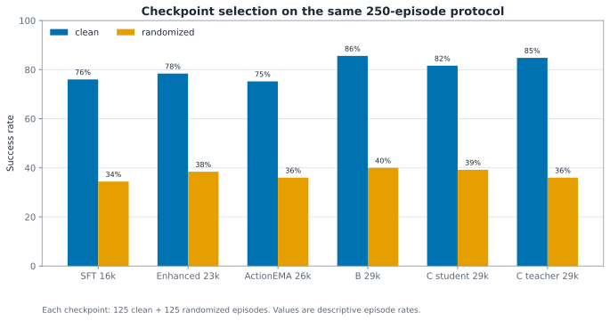
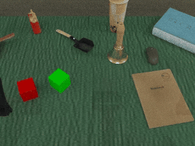
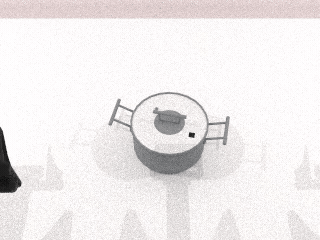
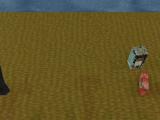
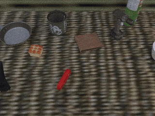
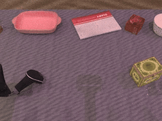
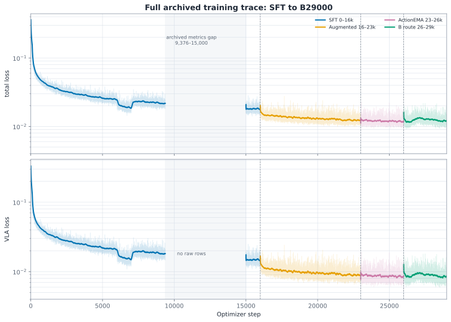

# LingBot-VLA 2.0: Post-Training, Closed-Loop Evaluation & RPent Integration

基于 LingBot-VLA 2.0，在 **RoboTwin 双臂仿真环境**中比较后训练路线、动作执行策略与高层规划对闭环任务表现的影响。先通过 Clean / Randomized 评测选择 checkpoint，再固定模型研究推理调度，最后将选定的 VLA 接入 RPent Agent，验证规划、工具执行和环境反馈的协作链路。

项目围绕三个问题展开：

- **后训练**：视觉增强和 teacher–student 约束能否改善场景变化下的任务表现？
- **推理执行**：动作块执行多长、何时重新观察，如何影响成功率和模型调用成本？
- **Agent 集成**：高层规划如何调用 VLA 与解析动作工具，并根据执行反馈继续决策？

## Highlights & Key Findings

| 方向 | 主要结果 | 实验含义 |
| --- | --- | --- |
| **后训练与模型选择** | **B29000：157/250 · 62.8%**，较 SFT 增加 **7.6 个百分点** | 在已测训练路线中选定后续底层权重 |
| **推理执行策略** | **Fixed20：167/250 · 66.8%**，较独立 Fixed50 增加 **3.2 个百分点** | 模型请求为 Fixed50 的 **2.36 倍**，体现反馈频率与计算成本的折中 |
| **RPent 系统集成** | **162/250 · 64.8%** | 完成 B29000 与 RPent 的多任务闭环验证；跨环境批次的差值不能解释为严格因果增益 |

B29000 的 Clean / Randomized 成功率分别为 **85.6% / 40.0%**。相较 SFT，分别提高 9.6 和 5.6 个百分点，但两种设置仍相差 **45.6 个百分点**。后训练改善了本批次结果，Randomized 场景仍是主要瓶颈。

## Demo Gallery

[打开 8 个原视频播放页](https://cc-hh-nn.github.io/lingbot-vla-rpent/assets/demos/)

以下为 **RPent Agent＋B29000** 的 8 个代表性成功回合，覆盖双臂协作、堆叠、多物体操作和随机场景。均使用 **BF16、Fixed50、10 次去噪、Medium 规划与 RPent 发布记忆**。动图以 10 fps 循环播放，保留完整画面和原播放速度；点击可查看原始 20 fps MP4。

<table>
<tr>
<td align="center"> <b>双积木堆叠 · Clean</b></td>
<td align="center"> <b>双积木堆叠 · Randomized</b></td>
</tr>
<tr>
<td align="center"> <b>按颜色排列积木 · Randomized</b></td>
<td align="center"> <b>双臂抬锅 · Clean</b></td>
</tr>
<tr>
<td align="center"> <b>物体放置 · Randomized</b></td>
<td align="center"> <b>物体入篮与提篮 · Randomized</b></td>
</tr>
<tr>
<td align="center"> <b>按压订书机 · Randomized</b></td>
<td align="center"> <b>双臂协作扫码 · Randomized</b></td>
</tr>
</table>

任务名称、setting、seed 和原文件 SHA 见 [Demo 清单](assets/demos/manifest.json)。这 8 个成功样例用于展示执行过程，总体表现见下方 250 回合评测。

## System Architecture

系统包含模型后训练、RoboTwin 闭环评测、动作执行调度和 RPent 高层规划四部分。先选模型，再固定 checkpoint 比较执行策略，最后验证 Agent 集成，分别记录每一层的结果和成本。

| 层级 | 上游能力 | 本项目的实现 |
| --- | --- | --- |
| 后训练 | LingBot-VLA 2.0 | 多阶段配方、teacher 约束与 checkpoint 比较 |
| 仿真与评测 | RoboTwin | 公共场景清单、seed/初态记录、动作预算和失败分类 |
| 推理执行 | VLA 动作块预测 | 固定窗口、论文 AutoHorizon 适配、异步队列和 guided RTC |
| Agent | RPent 规划、工具与记忆 | B29000 qpos14 适配、三相机映射、服务身份验证和闭环接入 |
| 结果分析 | 逐回合记录 | 训练曲线、任务级成功率、请求次数与前向耗时对照 |

## Evaluation Protocol

每组实验配置评测 **250 回合：25 个任务 × 2 种场景设置 × 每种设置 5 个预定义场景实例**。Clean 和 Randomized 各 125 回合。

| 项目 | 设置 |
| --- | --- |
| 基础模型 | LingBot-VLA 2.0 6B |
| 训练数据 | RoboTwin clean，50 个任务、2,500 条示教、549,787 帧 |
| 后训练资源 | 4×H100、FSDP2、Muon＋AdamW、global batch 256 |
| 场景设置 | `demo_clean` / `demo_randomized` |
| VLA 默认推理 | BF16、10 次去噪、batch size 1、预测动作窗 50 |
| 成功判据 | RoboTwin 原生 `eval_success` |

本组实验评估固定任务集合下的场景鲁棒性，不据此主张未见任务泛化。每回合记录 checkpoint、任务、场景、请求 seed、实际 seed、动作预算和最终状态。初始化或专家规划故障与正常策略失败分开记账；只有预定义的客观环境故障允许顺延 seed，正常失败保留在分母中。

同一批次使用冻结的公共场景。跨服务器评测保留各自批次来源，Agent 还存在环境版本与原生初始化顺延差异。协议与结果说明见 [评测协议](docs/experiment-protocol.md)和[结果说明](docs/results-summary.md)。

## Post-Training Experiments

### 路线与假设

先建立 SFT 基线，再针对 Clean / Randomized 差距逐步加入视觉增强和 teacher 约束。B 路线固定 clean teacher，约束增强视图下的 student 输出，希望在外观变化时保留原有动作能力；C 路线改为动态 EMA teacher，考察随 student 更新的监督目标能否取得更好的闭环结果。

| 路线 | 训练阶段 | 主要变化 | 评测权重 |
| --- | --- | --- | --- |
| SFT baseline | 0 → 16,000 | clean 示教监督微调 | SFT16000 raw |
| Enhanced | 16,000 → 23,000 | 颜色、噪声、模糊、JPEG 等视觉增强 | Enhanced23000 raw |
| ActionEMA | 23,000 → 26,000 | 维护动作模块 shadow EMA | ActionEMA26000 |
| B route | 26,000 → 29,000 | 固定 clean teacher、增强视图一致性 | **B29000 student** |
| C route | 26,000 → 29,000 | dynamic EMA teacher | C29000 student / teacher |

### Checkpoint 结果

每份权重包含 125 个 Clean＋125 个 Randomized 回合。前四份来自 checkpoint 筛选批次，C student / teacher 来自后续同规模评测。

| Checkpoint | Clean | Randomized | Overall |
| --- | ---: | ---: | ---: |
| SFT16000 raw | 95/125 · 76.0% | 43/125 · 34.4% | 138/250 · 55.2% |
| Enhanced23000 raw | 98/125 · 78.4% | 48/125 · 38.4% | 146/250 · 58.4% |
| ActionEMA26000 | 94/125 · 75.2% | 45/125 · 36.0% | 139/250 · 55.6% |
| **B29000 student** | **107/125 · 85.6%** | **50/125 · 40.0%** | **157/250 · 62.8%** |
| C29000 student | 102/125 · 81.6% | 49/125 · 39.2% | 151/250 · 60.4% |
| C29000 dynamic-EMA teacher | 106/125 · 84.8% | 45/125 · 36.0% | 151/250 · 60.4% |

B29000 比 SFT 多成功 19 回合，被选为后续主权重。C student 与 teacher 总分相同，Clean / Randomized 分布不同，均未超过 B29000；更多训练和 EMA 也没有带来单调改善。各路线同时改变了训练步数及配方因素，这些结果支持路线选择，不能单独归因为一致性约束或 EMA 的净收益。

**B29000 的两组分数对应不同批次。** checkpoint 筛选为 **157/250（62.8%）**；后续独立 Fixed50 复核为 **159/250（63.6%）**，同批次 B29000 也高于两份 C 权重。前者用于模型选择，后者作为推理策略基线，分别保留统计。

### 训练曲线

曲线覆盖已归档的 SFT 到 B29000 训练日志。9,376→15,000 步保留真实日志缺口，没有插值。训练 loss 用于检查优化过程，checkpoint 选择依据固定评测集上的闭环成功率。

## Inference Optimization

固定 B29000，保持预测动作窗 50，比较实际执行长度、异步请求和前缀引导。重新观察的频率会同时影响反馈、连续性和模型调用成本。

| Strategy | 执行方式 | Overall | Clean | Randomized | 请求次数 | 前向中位数 |
| --- | --- | ---: | ---: | ---: | ---: | ---: |
| Fixed50 | 同步执行 50 步 | 63.6% | 107/125 | 52/125 | 1,725 | 0.705 s |
| Fixed30 | 同步执行 30 步 | 59.6% | 103/125 | 46/125 | 3,024 | 0.695 s |
| **Fixed20** | 同步执行 20 步 | **66.8%** | 110/125 | 57/125 | 4,073 | 0.485 s |
| AutoHorizon | 按动作注意力选择执行前缀 | 62.0% | 106/125 | 49/125 | 3,483 | 0.555 s |
| Async25 | 执行旧动作时异步生成下一块 | 65.2% | 110/125 | 53/125 | 3,336 | 0.695 s |
| RTC25 | 异步生成，并用未执行前缀引导 | 60.0% | 105/125 | 45/125 | 3,561 | 1.802 s |

前向耗时来自各策略实际模型请求，观察分布随执行轨迹变化，不能当作相同输入下的算子速度对照，也不等于端到端任务时长。原始统计见 [inference_comparison.csv](results/inference_comparison.csv)。

**反馈频率与成本。** Fixed20 在当前批次最高，比 Fixed50 多成功 8 回合，请求约为 2.36 倍；Fixed30 反而下降，执行窗口与成功率并非单调关系。这里的改善伴随更多模型调用。

**RTC 的结果与计算开销。** RTC25 为 150/250，低于 Fixed50 的 159/250，前向中位数约为其 2.56 倍。guided RTC 包含动作前缀约束与 VJP 计算，增加了采样开销。当前实验尚未分别隔离计算延迟、动作交接和前缀参数的影响，因此只能确认本配置没有取得更高成功率，不能确定某一个因素就是失败原因，也不能外推为 RTC 在其他模型或平台上无效。

## RPent Agent Integration

### 规划、工具与 VLA 的分工

基于上游 RPent 框架，使用 **gpt-6.1-sol / Medium** 规划与发布的任务记忆。Agent 读取图像与工具反馈，选择 VLA 或解析动作工具，再根据执行结果继续决策。VLA 保留 B29000 权重，根据三相机、机器人状态和**原始任务语言**生成 qpos14 动作；Agent 提供给 VLA 工具的临时子目标不替换该语言输入。

RPent 记忆提供任务经验和工具使用参考，在规划上下文中使用。它与 VLA checkpoint 分开管理，不写入模型参数；更换底层 VLA 后仍需验证这些经验的适用性。

### 接口与执行链路

| 接入点 | 实现内容 | 代码入口 |
| --- | --- | --- |
| 观测与动作 | 三相机映射、qpos14 状态/动作布局、50×14 输出校验 | [rpent_qpos14_adapter.py](src/rpent_qpos14_adapter.py) |
| 模型服务 | endpoint 元数据、会话 reset、checkpoint/协议身份核验 | [b29000_vla_client.py](src/b29000_vla_client.py) |
| 请求隔离 | 显式 noise seed、请求序号、响应匹配，拒绝重复或跨回合响应 | [checkpoint_shared_rpc.py](src/checkpoint_shared_rpc.py) |
| 评测记录 | 动作预算、原生成功判定、初始化故障与策略失败区分、结果续接 | [评测协议](docs/experiment-protocol.md) |

规划器、工具 schema、提示词和记忆遵循 RPent 上游实现；适配工作集中在 VLA 合同、传输和闭环接入。图像与动作服务通过独立运行环境连接。

### 多任务结果

| 条件 | Clean | Randomized | Overall |
| --- | ---: | ---: | ---: |
| 纯 VLA · B29000 | 107/125 · 85.6% | 52/125 · 41.6% | 159/250 · 63.6% |
| RPent Agent＋B29000 | 107/125 · 85.6% | 55/125 · 44.0% | 162/250 · 64.8% |

250 回合验证了规划—工具—VLA—反馈的完整协作链路。Agent 与纯 VLA 的环境版本、初态和 seed 处理并非完全同源，这里的差值保留为系统评测结果，不作为严格因果提升。

## Task-Level Results & Limitations

热力图保留四份 checkpoint 与 Agent 的逐任务结果；C student / teacher 的汇总见 checkpoint 表。以下列出三类实际差异，每个单元为成功回合数 / 5：

| 任务与设置 | SFT16000 | B29000 | RPent Agent | 观察 |
| --- | ---: | ---: | ---: | --- |
| `put_bottles_dustbin` · Clean | 2/5 | 5/5 | 4/5 | 后训练批次改善明显，Agent 未进一步提高 |
| `place_a2b_left` · Randomized | 1/5 | 1/5 | 4/5 | Agent 系统批次更好，具体机制需结合执行记录验证 |
| `lift_pot` · Randomized | 0/5 | 0/5 | 0/5 | 在这些场景中，后训练与高层规划均未解决任务 |

任务级差异提示了后续诊断方向，但每个设置仅 5 回合，不能仅凭成功率判断是感知、规划、接触还是动作能力导致失败。跨批次初态差异也限制 Agent 比较。上述百分点差值均为当前实验的描述性结果，未经过多批次重复或显著性检验。

## Code & Results

| 入口 | 阅读内容 |
| --- | --- |
| [rpent_qpos14_adapter.py](src/rpent_qpos14_adapter.py) / [b29000_vla_client.py](src/b29000_vla_client.py) | 当前 RPent 接入的观测、动作与服务协议 |
| [chunk_executor.py](src/chunk_executor.py) | 固定窗口、异步队列和旧动作交接 |
| [autohorizon.py](src/autohorizon.py) | 论文自适应执行前缀计算 |
| [rtc_core.py](src/rtc_core.py) / [rtc_lingbot.py](src/rtc_lingbot.py) | 前缀权重、VJP 引导和 LingBot 采样适配 |
| [v2_qpos14_server.py](src/v2_qpos14_server.py) | qpos14 推理服务入口 |
| [plot_showcase.py](scripts/plot_showcase.py) | 训练曲线、成功率与任务热力图 |
| [tests/](tests/) / [ARCHITECTURE.md](ARCHITECTURE.md) | 接口、执行与结果记录的回归检查及模块说明 |

- [checkpoint_summary.csv](results/checkpoint_summary.csv)：checkpoint 的 Clean / Randomized 汇总。
- [per_task_checkpoint.csv](results/per_task_checkpoint.csv)：25 任务、四份 checkpoint 与 Agent 的逐任务结果。
- [inference_comparison.csv](results/inference_comparison.csv)：六种推理策略的成功率、请求次数与前向耗时。
- [training_full.csv](results/training_full.csv)：从 SFT 到 B29000 的已归档训练曲线采样。

## References

- [LingBot-VLA 2.0](https://github.com/Robbyant/lingbot-vla-v2)
- [RoboTwin](https://github.com/RoboTwin-Platform/RoboTwin)
- [RPent](https://github.com/RLinf/RPent)
- [AutoHorizon](https://github.com/hatchetProject/AutoHorizon)
- [Real-Time Chunking](https://github.com/Physical-Intelligence/real-time-chunking-kinetix)
- Kassis et al., *Scientific Agent Skills: A Library of Procedural Knowledge for Research Agents*, [arXiv:2609.00065](https://arxiv.org/abs/2609.00065) (2026)

第三方说明见 [THIRD_PARTY_NOTICES.md](THIRD_PARTY_NOTICES.md)。
