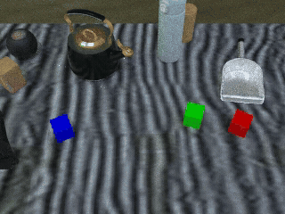
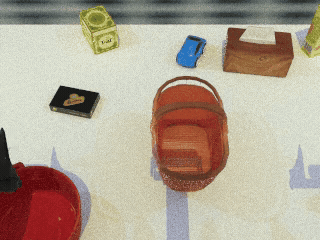
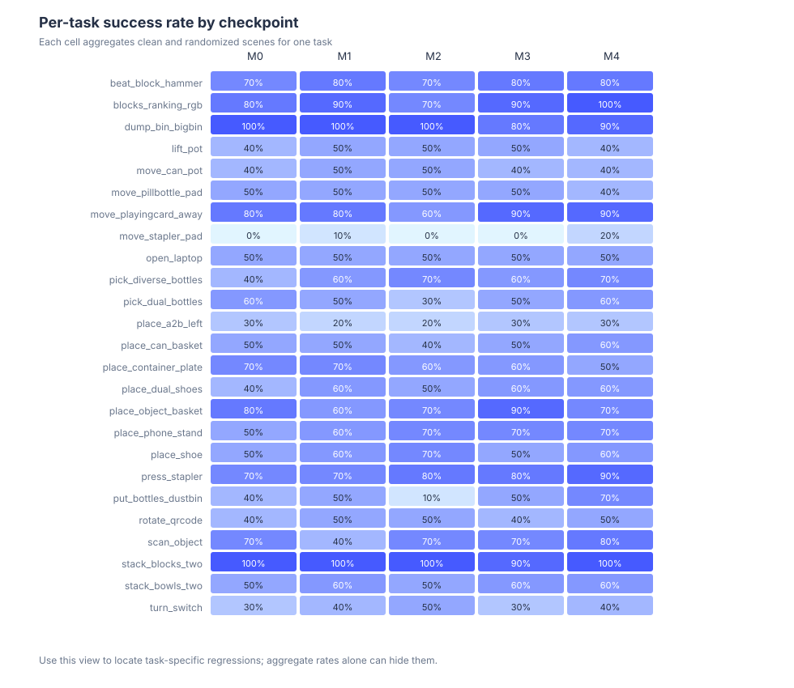

# LingBot-VLA 2.0: Post-Training, Inference & RPent Integration

## Overview

基于 **LingBot-VLA 2.0**，在 **RoboTwin 2.0 双臂仿真环境**中，围绕 VLA 后训练、推理优化与具身 Agent 集成开展实验，重点研究三个问题：

- **后训练：** 不同训练策略能否改善 VLA 在 Clean 与 Randomized 场景下的操作成功率？
- **推理优化：** 动作块的执行长度与反馈频率如何影响任务成功率和模型调用成本？
- **Agent 集成：** 如何将 VLA 接入 RPent，实现高层规划、工具调用与底层动作执行的闭环协作？

### Key Results

| 方向 | 核心结果 | 主要发现 |
| --- | --- | --- |
| **后训练** | **62.8%**（157/250） · **+7.6 pp** | Clean / Randomized 均有改善，随机场景仍是瓶颈 |
| **推理优化** | **66.8%**（167/250） · **+4.0 pp** | 20 步窗口本批次最高，模型请求 **2.36×** |
| **Agent 集成** | **64.8%**（162/250） · **+2.0 pp** | RPent 规划、工具调用与 VLA 执行的多任务闭环 |

### Demo

<table>
<tr>
<td align="center"> <b>双积木堆叠 · Clean</b></td>
<td align="center"> <b>双积木堆叠 · Randomized</b></td>
</tr>
<tr>
<td align="center"> <b>按颜色排列积木 · Randomized</b></td>
<td align="center"> <b>双臂抬锅 · Clean</b></td>
</tr>
</table>

更多 Demo：物体放置、提篮、订书机与扫码

<table>
<tr>
<td align="center"> <b>物体放置 · Randomized</b></td>
<td align="center"> <b>物体入篮与提篮 · Randomized</b></td>
</tr>
<tr>
<td align="center"> <b>按压订书机 · Randomized</b></td>
<td align="center"> <b>双臂协作扫码 · Randomized</b></td>
</tr>
</table>

## Experimental Setup

**评测设置：** 每组 **25 任务 × 2 设置（Clean / Randomized）× 5 seed＝250 回合**，采用 RoboTwin 原生成功判据。正常策略失败计入分母；初始化或专家规划故障按既定规则顺延 seed。评估范围为固定任务集合下的场景鲁棒性。

**默认推理配置：** **BF16 · 10 次去噪 · batch 1 · 50 步预测动作窗**。纯 VLA 基线同步执行 50 步（Fixed50），各推理策略的执行窗口与调度方式见下文对照。

## Post-Training

**方法。** 使用 RoboTwin clean 数据（50 任务、2,500 条示教、549,787 帧），在 **4×H100** 上以 FSDP2、Muon＋AdamW、global batch 256 训练。SFT 后逐步引入视觉增强与动作模块 EMA，再比较固定 clean teacher 的 B 路线和动态 EMA teacher 的 C 路线，检验增强视图约束下的闭环表现。

**结果。** Clean / Randomized 各 125 回合，总计 250 回合。

| Checkpoint | 方法与阶段 | Clean | Randomized | Overall |
| --- | --- | ---: | ---: | ---: |
| SFT16000 | 0→16k，clean 示教微调 | 76.0% | 34.4% | 138/250 · 55.2% |
| Enhanced23000 | 16→23k，颜色、噪声、模糊与 JPEG 增强 | 78.4% | 38.4% | 146/250 · 58.4% |
| ActionEMA26000 | 23→26k，维护动作模块 shadow EMA | 75.2% | 36.0% | 139/250 · 55.6% |
| **B29000 student** | **26→29k，固定 clean teacher、增强视图一致性** | **85.6%** | **40.0%** | **157/250 · 62.8%** |
| C29000 student | 26→29k，动态 EMA teacher 路线的 student | 81.6% | 39.2% | 151/250 · 60.4% |
| C29000 teacher | 同路线的动态 EMA teacher 权重 | 84.8% | 36.0% | 151/250 · 60.4% |

训练过程：SFT 到 B29000 的 loss 曲线

## Inference Optimization

**方法。** 固定 B29000 和预测动作窗 50，比较执行窗口、注意力自适应前缀、异步请求与 RTC 前缀引导。

**结果。** 每种策略评测 250 回合。

| Strategy | 执行方式 | 成功率 | 模型请求 | 前向中位数 |
| --- | --- | ---: | ---: | ---: |
| Fixed50 | 同步执行 50 步 | 63.6% | 1,725 | 0.705 s |
| Fixed30 | 同步执行 30 步 | 59.6% | 3,024 | 0.695 s |
| **Fixed20** | 同步执行 20 步 | **66.8%** | **4,073** | 0.485 s |
| AutoHorizon | 按动作注意力选择执行前缀 | 62.0% | 3,483 | 0.555 s |
| Async25 | 执行动作时异步生成下一块 | 65.2% | 3,336 | 0.695 s |
| RTC25 | 异步生成＋未执行前缀引导 | 60.0% | 3,561 | 1.802 s |

## RPent Integration

**方法。** 保留 RPent 上游规划、工具、提示词与发布记忆，使用 **gpt-6.1-sol / Medium**。Agent 根据图像和工具反馈选择 VLA 或解析动作工具；B29000 负责底层 qpos14 动作生成，接收三相机、机器人状态与原始任务语言。记忆作为规划上下文使用，与 VLA 参数分开管理。

| 接入环节 | 本项目实现 |
| --- | --- |
| 观测与动作 | 三相机映射、qpos14 状态/动作布局、50×14 输出校验 |
| 模型服务 | checkpoint / 协议身份核验、会话 reset、显式 noise seed 与请求响应匹配 |
| 闭环评测 | 原生动作执行、预算与成功判定、故障分类及已完成结果续接 |

**结果。** B29000 保持 BF16 / Fixed50 / 10 次去噪，未叠加推理优化。

| 系统 | Clean（125 回合） | Randomized（125 回合） | Overall（250 回合） |
| --- | ---: | ---: | ---: |
| 纯 VLA · B29000 | 107/125 · 85.6% | 52/125 · 41.6% | 159/250 · 63.6% |
| RPent＋B29000 | 107/125 · 85.6% | 55/125 · 44.0% | **162/250 · 64.8%** |

任务级表现：后训练与 Agent 的改善并不一致

## Code & References

| 核心代码 | 内容 |
| --- | --- |
| [rpent_qpos14_adapter.py](src/rpent_qpos14_adapter.py) · [b29000_vla_client.py](src/b29000_vla_client.py) | RPent 观测、动作与模型服务适配 |
| [v2_qpos14_server.py](src/v2_qpos14_server.py) · [checkpoint_shared_rpc.py](src/checkpoint_shared_rpc.py) | VLA 服务、请求隔离与随机上下文 |
| [chunk_executor.py](src/chunk_executor.py) · [autohorizon.py](src/autohorizon.py) | 固定窗口、异步动作队列与自适应前缀 |
| [rtc_core.py](src/rtc_core.py) · [rtc_lingbot.py](src/rtc_lingbot.py) | RTC 前缀约束、VJP 引导与 LingBot 采样适配 |

**上游项目：** [LingBot-VLA 2.0](https://github.com/Robbyant/lingbot-vla-v2) · [RoboTwin](https://github.com/RoboTwin-Platform/RoboTwin) · [RPent](https://github.com/RLinf/RPent) · [AutoHorizon](https://github.com/hatchetProject/AutoHorizon) · [Real-Time Chunking](https://github.com/Physical-Intelligence/real-time-chunking-kinetix)
